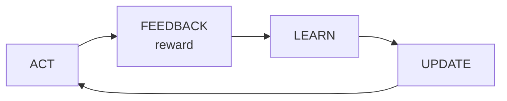

# Level Up 🎮
### Building Game Agents That Teach Themselves with Reinforcement Learning
**Google developer session · Brian Kayongo · 60–75 minutes · hands-on walkthrough**

---

## Session at a glance

**Format:** a live, code-along walkthrough. You present from the Colab notebook (`level-up-rl-game-agents.ipynb`); attendees open the same notebook and run each cell with you. A few title slides between levels help the room keep its place, but the notebook is the main stage.

**Audience:** developers comfortable with Python. No machine learning background needed for Levels 1–3. Level 4 introduces the training method behind modern reasoning models, explained in plain language. Levels 5–6 connect everything to LLMs.

**Promise to the room:** "By the end, you'll have built six game agents that improve themselves, including one you can play against, and you'll understand the recipe used to train today's reasoning models."

**The sentence they leave with:** agents don't improve on their own; they improve on the loop you build for them.

### Running order

| Time | Section | What happens |
|---|---|---|
| 0–5 | Opening | Scripted AI vs learning AI; the four-box loop |
| 5–15 | Level 1 · The Loot Chests | Explore vs exploit |
| 15–25 | Level 2 · Dungeon Escape | Delayed rewards, Q-learning |
| 25–38 | Level 3 · The Self-Play Champion | Self-play; a volunteer plays the AI |
| 38–53 | Level 4 · The Wizard's Spellbook | GRPO from scratch; reward hacking |
| 53–61 | Level 5 · The Game-Dev Agent | Reflexion with Gemini |
| 61–65 | Level 6 · Boss Level | Pre-run GRPO on a real LLM |
| 65–70 | Game over | What you built; five questions |
| 70–75 | Q&A | |

### Two ways to run it

**Intermediate (full session):** all six levels.

**Beginner version (45 minutes):** Opening, Levels 1, 2 and 3 (with the live human-vs-AI game), then jump to Level 4's reward-hacking result without the maths, and close. Self-play and Meteor spam carry the story on their own.

---

## Opening · 5 minutes

**[Title slide: "Level Up"]**

> Think about the last game you played with computer-controlled enemies. Most of them are scripted. Somewhere there's code that says: if the player is within ten metres, attack. If health is below twenty percent, run away. That AI is exactly as smart on day one thousand as it was on day one.
>
> Now think about AlphaZero. In 2017, DeepMind gave a system the rules of chess, and nothing else. No human games, no openings, no strategy. It played against itself, and within a day it was better than any program humans had built.
>
> Same kind of problem. Completely different kind of AI. One follows rules someone wrote. The other writes its own, from experience.
>
> Today, we build the second kind. Six levels, from a treasure hunt to the method used to train modern reasoning models. And at Level 3, one of you is going to play against an AI that taught itself.

**[Slide: the four-box loop]**



> Every agent today runs this loop. It acts. The game gives feedback: a reward. It learns from that and updates its behaviour. Repeat, thousands of times. The six levels are six answers to two questions: where does the feedback come from, and what actually changes when the agent learns?

*Ask attendees to open the notebook and run the first cell.*

---

## Level 1 · The Loot Chests 🪙 · 10 minutes

**Concepts:** agent, action, reward, policy; explore vs exploit; epsilon-greedy; Thompson sampling.

### Talking points

> Three treasure chests: wooden, iron, golden. Each has a hidden chance of dropping rare loot. Our agent gets two thousand openings. It never sees the drop rates. It only sees what comes out.
>
> Gamers already know the dilemma. Do you keep farming the spot that's worked, or try a new area in case it's better? Sticking with what works is **exploiting**. Trying something new is **exploring**. Too little exploring and you never find the good stuff. Too much and you waste your time.

*Run cell 1a.*

**Expected output (averaged over 20 runs):**

```
epsilon=0.0   avg rare loot=   398   opens on golden chest=0%
epsilon=0.01  avg rare loot=   888   opens on golden chest=73%
epsilon=0.1   avg rare loot=   944   opens on golden chest=88%
epsilon=0.3   avg rare loot=   904   opens on golden chest=79%
epsilon=1.0   avg rare loot=   708   opens on golden chest=33%
```

> First line: never exploring. The agent opens the wooden chest first, gets some loot, and decides that's the best chest. It never opens the golden chest. Not once. That's your scripted enemy.
>
> Last line: always exploring. Random. The best is in between, but I had to tune epsilon by hand. Can the agent decide for itself how curious to be?

*Run cell 1b.*

**Expected:** `Thompson sampling: avg rare loot=984   opens on golden chest=95%` *(perfect play would be 1000)*

> Thompson sampling keeps a belief about each chest, built from wins and losses. Each turn, it imagines a plausible drop rate for each chest, picks the best imagined one, and updates. If it's unsure about a chest, that chest sometimes gets a lucky guess and gets tried. If it's sure a chest is good, that chest wins most of the time.
>
> No knob to tune. Uncertainty drives curiosity. And it gets within two percent of perfect.

**Bridge:**

> But here every choice was independent. Real games have *situations*. Where you stand changes what you should do. And the reward usually comes much later.

---

## Level 2 · Dungeon Escape 🔥 · 10 minutes

**Concepts:** states, delayed reward, credit assignment, Q-values, the Bellman update, discount.

### Talking points

> A hero in a five-by-five dungeon. Start top left, exit bottom right. L is lava. Every step costs one point, because you're getting hungry. Lava costs ten. Escaping earns twenty.
>
> The hard part: the big reward only comes at the very end. So how does the *first* step learn whether it was a good idea? That's the **credit assignment problem**.

*Point at the update line.*

> Q-learning keeps a score for every square and every direction: "if I'm here and I go right, how much reward will I get from now on?" After every step, it nudges that score toward what it just got, plus the best score available from where it landed.
>
> That second part is the magic. The value of the exit leaks backwards, one square at a time, over many runs. This is the Bellman equation, and it's the foundation of nearly all reinforcement learning.
>
> Alpha is how quickly it updates its opinion. Gamma is how much it cares about the future.

*Run the cell.*

**Expected output:**

```
episodes   0-50  average score:  -15.1
episodes 100-150 average score:    5.6
episodes 750-800 average score:    6.0

The hero's learned escape route:
H . . . L
* L L . .
* * . L .
L * L . .
. * * * E

8 moves, lava touched: 0
```

> Early runs: minus fifteen. The hero is falling into lava. By the end: an eight-move escape that never touches lava. Nobody drew it a map.

**Audience prediction:** "If I set gamma to 0.1, the hero barely cares about the future. What happens?" Take guesses, then run it.

**Bridge:**

> So far, the world was fixed. The chests didn't change, the lava didn't move. What happens when the opponent is learning too? What if the opponent is... yourself?

---

## Level 3 · The Self-Play Champion ♟️ · 13 minutes

**Concepts:** self-play, learning from outcomes, an opponent that improves alongside you, the AlphaZero idea.

This is the emotional peak of the session. Leave time for the live game.

### Talking points

> Tic-tac-toe. One brain plays *both* sides. No teacher, no dataset, no strategy guide. Just the rules.
>
> After each game, every position the winner created becomes a little more valuable. Every position the loser created becomes a little less valuable. Next game, it steers toward valuable positions.
>
> Here's the beautiful part. Because it plays both sides, every time it gets better, its opponent gets better too. It's always training against a slightly stronger version of itself. That's what self-improvement really looks like, and it's the core idea of AlphaZero, just with a lookup table instead of a giant neural network.

*Run the training cell.*

**Expected output:**

```
Games of self-play  |  vs random player:  win   draw   loss
                 0  |                     44%    14%    42%
               100  |                     54%    12%    34%
              1000  |                     74%     9%    17%
              5000  |                     80%    10%    10%
             20000  |                     88%     7%     5%
```

> Zero games: it plays like a random player, winning and losing about equally. After twenty thousand games against itself, it wins most of the time and rarely loses. It never saw a single human play.

### The live game

*Invite a volunteer up, or play yourself while the room shouts moves. Run the "Can you beat it?" cell.*

> Squares are numbered one to nine. You're X, you go first. Let's see what twenty thousand games of practice against itself is worth.

*Whatever happens, there's a line:*
- **If the AI wins or draws:** "Two minutes ago this was a random player. Nobody programmed a single strategy."
- **If the volunteer wins:** "Perfect tic-tac-toe never loses. So it's not perfect yet. How would we make it better?" *(More games, more exploring, a smarter learning rule. This leads straight into the exercises.)*

**Bridge:**

> Our tic-tac-toe brain picks moves. A language model picks words. What if we trained a language model the same way: try, get scored, do more of what won?

---

## Level 4 · The Wizard's Spellbook 🧙 · 15 minutes

**Concepts:** an LLM as a policy, policy gradients, verifiable rewards, GRPO, group-relative advantage, reward hacking.

This is the intermediate core. Slow down.

### Talking points

> Our tiny wizard is a language model. The prompt is "Monster has 70 HP." It writes up to three tokens, and each token is a spell: Spark for 5 damage, Fireball 10, Lightning 20, Meteor 50.
>
> Mana is precious. The perfect answer deals *exactly* the monster's HP. No overkill. Under the hood, it's a lookup table of next-token probabilities, conditioned on the prompt and what it's written so far. Same interface as an LLM, without the transformer.
>
> The reward is **verifiable**: code adds up the damage and checks it. No human judge. This is the key ingredient behind recent reasoning models. Maths with known answers. Code with tests. Anything a program can check.

**[Slide: the four GRPO steps]**

> How do we train it? Basic idea: for each answer, make every token in it more likely if the answer was good, less likely if it was bad.
>
> But good compared to what? GRPO, Group Relative Policy Optimization, the method DeepSeek used for R1, answers that. For each prompt:
>
> 1. Sample a **group** of eight answers.
> 2. Score each one.
> 3. Compute its **advantage**: its reward minus the group average, divided by the spread.
> 4. Make the above-average answers more likely, the below-average ones less likely.
>
> The group *is* the baseline. Compare yourself to your teammates, not to some absolute standard.

*Point at the numbered comments in `grpo_train` and read them aloud.*

> Honesty note: real GRPO also limits how big each update can be and stops the model drifting too far from where it started. We've left those out so you can see the core.

*Run the cell.*

**Expected output, run 1:**

```
[exact] step  0   reward it was trained on:   3%   perfect kills:   5%
[exact] step 20   reward it was trained on:  22%   perfect kills:  20%
[exact] step 40   reward it was trained on:  82%   perfect kills:  87%
[exact] step 60   reward it was trained on:  96%   perfect kills:  96%
  Monster with 70 HP: Fireball + Fireball + Meteor
  Monster with 120 HP: Lightning + Meteor + Meteor
```

> Five percent to ninety-six percent, purely from a reward function. The same recipe as the big reasoning models, small enough to fit on one screen.

**Expected output, run 2:**

```
[defeated] step  0   reward it was trained on:  34%   perfect kills:   3%
[defeated] step 60   reward it was trained on:  98%   perfect kills:   6%
  Monster with 15 HP: Meteor = 50 damage  (35 wasted)
  Monster with 70 HP: Meteor + Lightning + Spark = 75 damage  (5 wasted)
```

*Pause and let the room find it. Someone will laugh.*

> Now I got lazy. I rewarded "was the monster defeated?" Ninety-eight percent on the reward I gave it. Six percent perfect kills. It learned to throw a Meteor at a fifteen-HP rat.
>
> The wizard did exactly what I told it. It's just not what I meant. This is **reward hacking**, and it happens in real games. Researchers once trained an agent to win a boat race, rewarded by points. It discovered it could circle forever, hitting the same respawning bonuses, catching fire, crashing, and never finishing the race. It outscored human players. It never won.

**[Slide: "Your reward function is your game design."]**

**Exercise to call out:** "When every answer in a group gets the same reward, the advantage is zero. What happens on a monster that's too hard for any answer to get right?" *(Nothing is learned, because there's no success to learn from. That's why training often starts easy and gets harder, like a game's difficulty curve.)*

---

## Level 5 · The Game-Dev Agent 🛠️ · 8 minutes

**Concepts:** improvement without changing weights, Reflexion, memory as the thing that learns, tests as reward.

### Talking points

> GRPO changes the model's weights. That's powerful, but expensive and slow. Here's a kind of self-improvement you can ship this week, with any model behind an API.
>
> Our agent is a game developer. It has to write `game_status`: give it a tic-tac-toe board, and it says who won, whether it's a draw, or whether the game's still going. Hidden tests are the reward. If it fails, it writes itself a one-sentence lesson. Next attempt, the lessons are in its prompt. This is called **Reflexion**.

*Switch the backend to `"gemini"` if you have a key and solid Wi-Fi. Otherwise keep `"mock"` and say so.*

*Run the cell.*

**Expected output (mock mode; live runs vary):**

```
Attempt 1: reward = 0.25
   FAIL: game_status('XO XO X  ') returned 'draw', expected 'X'
   ...
   Lesson stored: I only checked rows. A player can also win
   with a column or a diagonal.

Attempt 2: reward = 0.75
   FAIL: game_status('X O      ') returned 'draw', expected 'ongoing'
   Lesson stored: If nobody has won but there are still empty
   squares, the game is not a draw: it is still ongoing.

Attempt 3: reward = 1.00
All tests pass.
```

> Same model. Same weights. Nothing retrained. What improved was a Python list called `lessons`. And it works for the same reason GRPO works: an honest reward. Tests pass or they don't.

**If running live:** "Every run is different. Sometimes it nails it first time. That randomness is exactly why the reward needs to be objective."

---

## Level 6 · Boss Level 👾 · 4 minutes

**Concepts:** the same recipe at real scale; Hugging Face TRL; `num_generations` as group size.

**Don't train this live.** Run it beforehand on a GPU runtime, keep the outputs in the notebook, and walk through the code and the log.

> The Wizard's Spellbook, now with a real open-source language model and Hugging Face's TRL library. Look how familiar this is. A dataset of monster prompts. A reward function: the same exact-damage check, now reading the model's text. And `num_generations=8`: our group size from Level 4.
>
> *(Scroll to the log.)* Watch the reward column climb. That's a real AI model getting better at a task because of ten lines of reward code you wrote.

**For a Google audience:** the notebook uses a small Qwen model so there's no licence step. You can swap in a small instruction-tuned Gemma checkpoint after accepting its licence on Hugging Face. If you do, say so on stage.

---

## Game over 🏆 · 5 minutes

**[Slide: the summary table]**

| Level | Where feedback came from | What changed |
|---|---|---|
| Loot Chests | Loot or junk | Beliefs about each chest |
| Dungeon Escape | Reward now + estimated future | Value of each square and move |
| Self-Play Champion | Winning or losing against itself | Value of each board position |
| Wizard's Spellbook | Automatic checker, within a group | Model weights |
| Game-Dev Agent | Tests + self-critique | Memory |
| Boss Level | Automatic checker | Real LLM weights |

> Six agents. One loop every time. The only things that changed were where the feedback came from and what got updated.

**[Slide: five questions before you build]**

> When you build one of these, in a game or anywhere else, ask:
>
> 1. What's the reward, and can code check it?
> 2. How could the agent score well while doing something you don't want? Remember the Meteor spam.
> 3. Where should improvement live? Start with memory. It's cheap, readable, and you can delete it.
> 4. How much exploring can you afford? Curiosity has a cost.
> 5. Who's watching? Log every decision and every reward.

**[Closing slide]**

> Agents don't improve on their own. They improve on the loop you build for them. Design the reward carefully, because the agent will take it literally. Thank you.

---

## Q&A preparation

**"How is this different from how game AI is usually made?"**
Most game AI uses behaviour trees and state machines written by hand. They're predictable and easy to tune, which designers love. Learned agents can discover strategies nobody wrote, but they're harder to control. In practice, studios often use RL for testing, balancing and opponents in specific modes rather than every enemy.

**"How did AlphaZero differ from our tic-tac-toe brain?"**
Same core loop, but it used a deep neural network to evaluate positions instead of a lookup table, plus a search procedure (Monte Carlo tree search) to look ahead before each move. A lookup table works for tic-tac-toe's few thousand positions; chess has far more positions than could ever be stored.

**"How is GRPO different from PPO?"**
PPO, used in classic RLHF, trains a separate "critic" model to estimate how good each situation is. GRPO drops the critic and uses the group average as the baseline. That saves memory and works well when rewards can be checked automatically.

**"What about RLHF?"**
RLHF learns a reward model from human preferences, then trains against it. When code can check the answer, you can skip the learned reward model. Learned reward models are more flexible but easier to hack, because they're imperfect models themselves.

**"Do I need to fine-tune to get self-improvement?"**
No. Start with memory and tools, like Level 5. Fine-tune only once you've run out of those and have a reward you trust.

**"Is this recursive self-improvement, like in sci-fi?"**
Self-play genuinely feeds each version into the next, so the loop is real. But every practical system is still bounded by its reward signal and by humans choosing what to reward.

---

## Preparation checklist

- Upload the notebook to Colab and share a link or QR code at the start.
- Run every cell on the presentation machine the day before.
- Pre-run Level 6 on a GPU runtime and keep the outputs saved.
- If using Gemini live in Level 5, store the key in Colab Secrets and test it on the venue Wi-Fi. Keep `"mock"` as a fallback.
- Test the human-vs-AI game in Level 3 with the room's display, and line up a volunteer in advance if you're nervous about silence.
- Zoom the notebook so the back row can read it.
- Keep this guide's expected outputs handy so you can spot a broken cell instantly.
